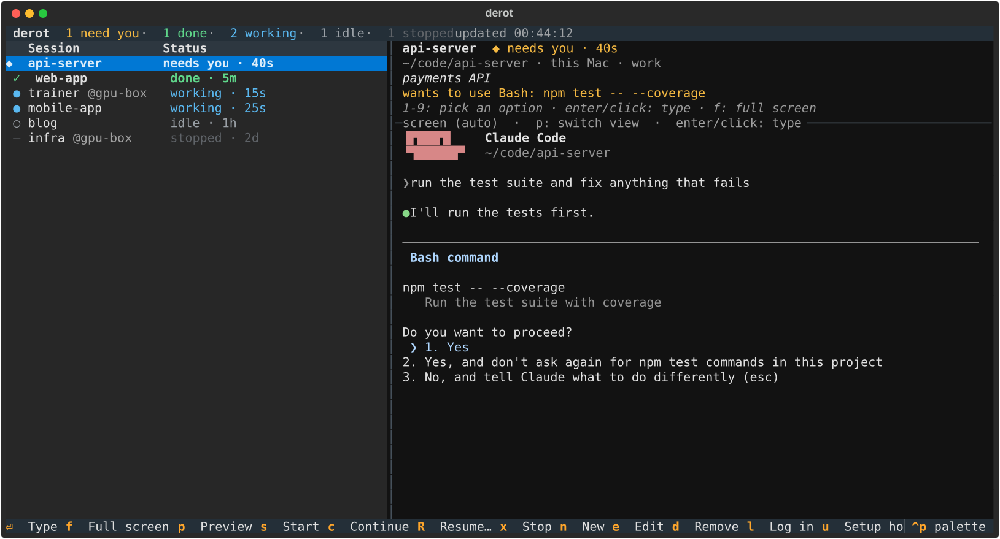
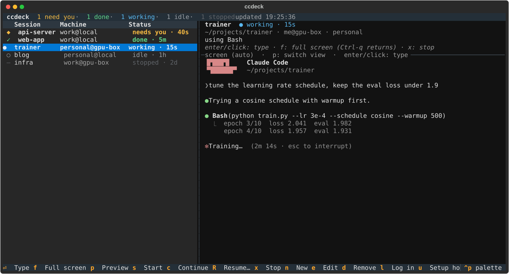
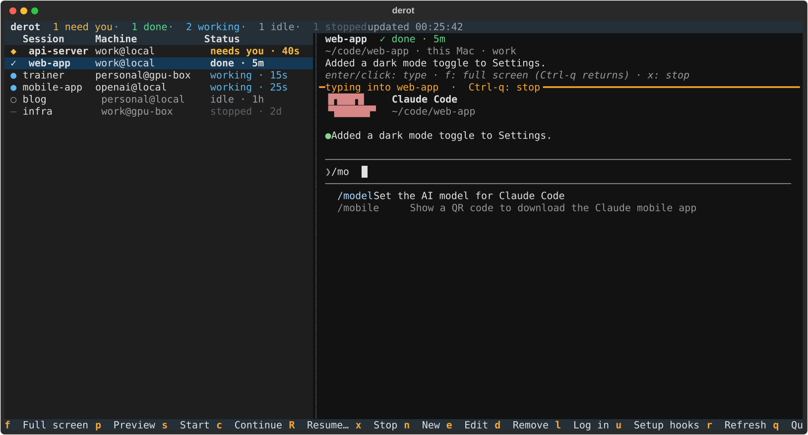
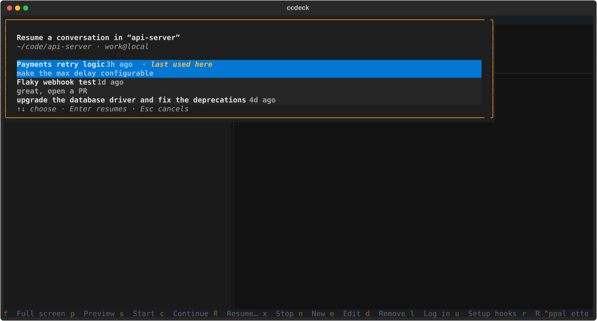
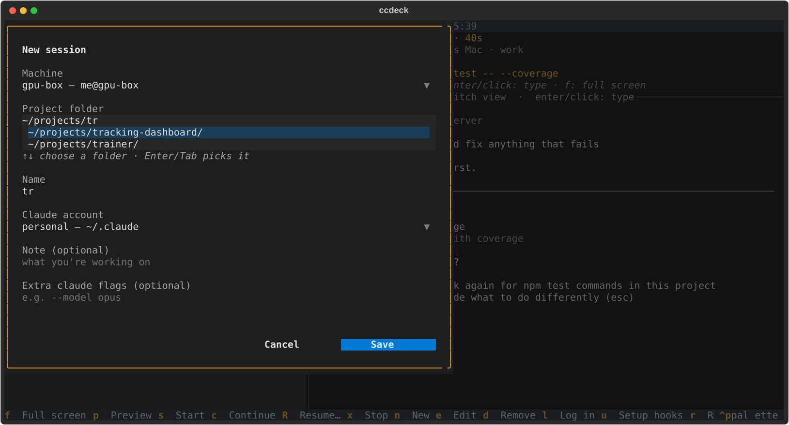
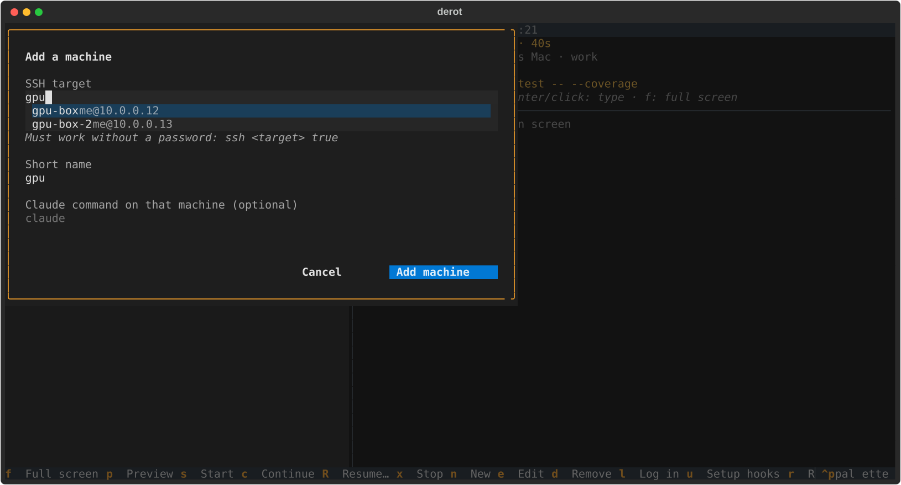
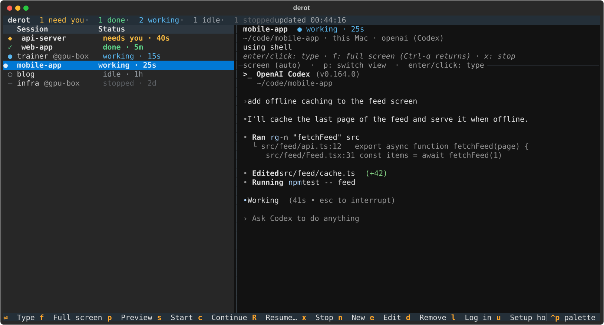

# derot

[](https://github.com/rootonchair/derot/actions/workflows/tests.yml)
[](https://pypi.org/project/derot/)
[](https://github.com/rootonchair/derot/blob/main/LICENSE)

**Stop coding-agent sessions rotting in forgotten terminals.** derot is one terminal console
for every **Claude Code** and **Codex** session you run: across **projects**, **accounts** and
**machines** (this computer plus any machine you can SSH into), in one list.
See which sessions need you, watch the agent work, and type into any of them without leaving
the console.



## Features

**Every session at a glance.** Sessions that need you (a permission prompt or a question
with options) sort to the top, then finished ones, then the ones still working. The summary
bar counts them, and you get a desktop notification when a session needs you.

**Watch the agent work.** The right-hand panel shows the selected session's details and
its live screen, exactly as Claude Code or Codex draws it, for local and SSH sessions alike.



**Type into any session from the console.** Press Enter or click the right panel and every
key goes straight to Claude: slash commands, `/model`, menus, autocomplete, Esc, paste. Press
`1`–`9` on the list to answer a prompt in one keystroke, or `f` for Claude's own full-screen
UI. `Ctrl-q` always brings you back.



**Pick up old conversations.** `R` lists a session's past conversations with their titles,
age and last prompt, and resumes the one you pick. `c` continues the session's own last
conversation.



**No YAML required.** Add sessions, machines and accounts from forms. The project folder
field lists matching folders as you type, on the chosen machine (over SSH for remote ones),
and the SSH target field lists hosts from your `~/.ssh/config` and `known_hosts`.





**Claude Code and Codex side by side.** Each account belongs to an agent, so Claude Code
and OpenAI Codex sessions share one list, with the same status, preview, typing and resume.



**Sessions outlive the console.** Every session runs in tmux, so it keeps going when you
quit derot, close the laptop lid or lose the SSH connection.

## How it works

- **tmux**: each session is a tmux session `cc-<name>` on a private tmux server
  (`tmux -L derot`), so it survives detaching and never touches your own tmux setup.
- **SSH**: remote hosts are reached with plain `ssh` (shared ControlMaster connection, one
  call per host per refresh). Nothing runs on the VM besides tmux, python3 and the agent.
- **Hooks**: `derot setup` installs a tiny stdlib-only script, `~/.derot/hook.py`, and
  registers it as a Claude Code or Codex hook (both agents have the same hook events). It writes `~/.derot/state/<name>.json` on each event
  (prompt submitted, tool use, permission prompt, stop), so status is accurate without screen
  scraping.
- **Accounts**: each account is an agent's config folder, with its own login and settings:
  a Claude Code folder passed via `CLAUDE_CONFIG_DIR`, or a Codex folder passed via
  `CODEX_HOME`. For Codex, setup registers the same hook in that folder's `hooks.json`.

## Install

Requirements: Python 3.9+, [tmux](https://github.com/tmux/tmux), and
[Claude Code](https://docs.anthropic.com/en/docs/claude-code) and/or
[Codex](https://developers.openai.com/codex) on every machine you use.
Developed and used on macOS; the Linux code paths (tmux, `notify-send` notifications) are
covered by CI but haven't seen much real use yet.

```sh
pipx install derot        # or: uv tool install derot
```

(No pipx yet? On macOS `brew install pipx`, on Debian/Ubuntu `sudo apt install pipx`.)

Upgrade with `pipx upgrade derot` (or `uv tool upgrade derot`). For the latest unreleased
code from `main`: `pipx install git+https://github.com/rootonchair/derot`.

Each SSH machine needs `python3`, the agent(s) you use there, and key-based SSH access
(`ssh my-vm true` works without a password prompt). It also needs tmux, but you don't have to
install it yourself: when a machine doesn't have it, `derot setup` (or `u` in the console)
offers to install it with that machine's package manager (Homebrew, apt, dnf, yum, pacman or
apk) and asks first. `derot setup --yes` answers yes for you.

## Setup

1. Run `derot`. On first run it creates `~/.config/derot/config.yaml` (override with
   `DEROT_CONFIG`) and opens the console.
2. Press `n` to add a session: pick a machine, a project folder (matching folders are listed
   as you type) and a Claude account. Choose **+ add a machine (SSH)…** or **+ add an account…** in the dropdowns
   to create those on the spot. Saving installs the status hooks for any new machine/account
   automatically, and offers to log in to a new account right away.
3. Press `Enter` on a session to start it and type into it from the right panel; `Ctrl-q`
   stops typing. `f` opens Claude's own full-screen UI instead.

No YAML editing needed. `e` edits the selected session, `d` removes it, `l` logs in to the
session's account (Claude Code opens so you can `/login`; for Codex it runs `codex login`). The config file is still plain YAML if you
prefer it (`E` opens it in `$EDITOR`); saving from the console rewrites it without comments
and keeps your original as `config.yaml.bak`.

A VM needs tmux, python3, Claude Code and/or Codex, and key-based SSH (`ssh my-vm true`
works without a password prompt). From the command line, the same setup is `derot login ACCOUNT [--host H]`
and `derot setup`.

<details><summary>Config file reference</summary>

```yaml
hosts:
  vm:
    ssh: user@my-vm            # anything `ssh` accepts, incl. ~/.ssh/config aliases
    claude: claude             # optional: command/full path for Claude Code there
    codex: codex               # optional: command/full path for Codex there
accounts:
  personal: {config_dir: ~/.claude}
  openai: {agent: codex, config_dir: ~/.codex}   # agent: claude (default) or codex
  work:
    config_dir: ~/.claude-work
    env: {ANTHROPIC_API_KEY: sk-ant-...}   # optional
sessions:
  - {name: shop-api, host: local, dir: ~/code/shop-api, account: work, note: payments refactor}
  - {name: infra,    host: vm,    dir: ~/infra,         account: work, args: "--model opus"}
notify: {on_waiting: true, on_done: true, sound: Glass}
refresh: 3
detach_key: C-q
```

</details>

## Keys

The console has the session list on the left. On the right are the selected session's
details and a **preview**. The preview shows the session's live screen, exactly as Claude draws
it (the same view you get when typing live or attaching); stopped sessions show their last
conversation instead. Press Enter (or click the right panel) to type straight into the
session from the preview (slash commands, `/model` and menus all work), or `1`–`9` to pick a
prompt option. Go full screen (`f`) only for longer work.

| Key | Action |
|---|---|
| `Enter` / click the right panel | Type into the selected session: every key (letters, `/`, arrows, Tab, Esc, Ctrl-C, paste) goes straight to Claude, and the preview shows Claude's own UI updating as you type, including slash-command menus, `/model`, autocomplete and pickers. Starts the session first if it's stopped. `Ctrl-q` stops typing. A click on a row only selects it |
| `f` | Full screen: Claude's own UI in this terminal (attach; starts it first if stopped). `Ctrl-q` comes back |
| `1`–`9` | When a session needs you: pick that numbered option in its prompt |
| `p` | Preview: switch between auto (screen while running, conversation once stopped), conversation (from Claude's transcript) and screen |
| `s` | Start fresh in the background and stay in derot (watch it in the preview, Enter to type) |
| `c` | Continue this session's last conversation (falls back to the folder's newest, `claude --continue`), in the background like `s` |
| `R` | Resume: pick any past conversation of the session's folder and account (title, age, last prompt), then start it with `claude --resume` |
| `x` `x` | Stop (press twice within 3 s) |
| `n` | New session (form) |
| `e` | Edit the selected session (form) |
| `d` | Remove the selected session from derot |
| `l` | Log in to the selected session's account (`/login`) |
| `E` | Open the config file in `$VISUAL`/`$EDITOR`, reload on exit |
| `u` | Run setup (install hooks) |
| `r` | Refresh now |
| `q` | Quit (sessions keep running) |

Inside a session, `Ctrl-q` (configurable with `detach_key`) returns to derot. `Ctrl-b d`
always works too. Coming back from a finished session marks it as seen (done → idle).

## Command line

```
derot                      open the console (creates the config on first run)
derot init                 create the config file
derot setup [--remove]     install / remove status hooks on every host+account
derot ls                   print a status table
derot start NAME [-c] [-r ID] [-d]   start (-c continue last conversation, -r resume that
                                      conversation, -d don't attach)
derot history NAME [-n N]            list past conversations (ids for -r)
derot attach NAME          attach, then mark seen
derot stop NAME
derot watch                poll + notifications only, for when the console is closed
derot login ACCOUNT [--host H]
derot log [-f] [-n N]       show the log, for tracing errors
```

`derot watch` gives you desktop alerts without keeping the console open, e.g. in a spare
terminal tab or a login item.

## Troubleshooting

Start with the log: **`derot log`** shows the last lines of `~/.derot/derot.log`
(`derot log -f` follows it live). It records every action, every failure with the full error
output, and tracebacks for anything unexpected. Error toasts in the console are logged too, so
a message that disappeared can still be read there. For even more detail, run with
`DEROT_DEBUG=1 derot` to log every command derot runs (API keys are masked). Errors inside
the status hook itself go to `~/.derot/hook-errors.log` on that machine.

- **`claude` not found**: sessions run in your login shell, but if it still isn't found set
  `claude:` to the full path for that host (`which claude` on that machine).
- **Session shows "needs you: Claude hasn't started yet"**: Claude is on a screen that comes
  before the session, such as "trust this folder?" or a new account's login. Press Enter (or
  click the right panel) and answer it. If nothing is there, press `u` to reinstall the hooks.
- **Codex session shows "needs you: Codex isn't running derot's hooks yet"**: Codex only
  runs hooks you've approved. Press Enter on the session (or click the right panel), type
  `/hooks`, and trust derot's hooks (`t`). It's once per account folder. A Codex session that
  has started but hasn't had a prompt yet shows idle: Codex reports nothing before the first
  prompt.
- **Codex session shows "needs you: Codex isn't logged in"**: a new Codex account folder
  has no login yet. Press `l` (on an SSH machine it signs in with a one-time code), or press
  Enter and answer Codex's sign-in screen. An account with `OPENAI_API_KEY` in its `env` logs
  in with that key when a session starts (Codex ignores the variable on its own).
- **Session stuck on idle**: status hooks are missing for that account/host. Starting a
  session sets them up; otherwise press `u` (or run `derot setup`).
- **Two accounts log each other out on the Mac**: Claude Code stores logins in the macOS
  keychain, so two subscription logins can clash. Give one account an API key via its `env`
  (`ANTHROPIC_API_KEY: ...`).
- **Detach key conflicts** with an app you use inside sessions: change `detach_key` (e.g.
  `C-]`). `Ctrl-b d` always works.
- **Sessions started outside derot don't appear**: derot only tracks sessions it starts.
  Add them with `n`, exit the old `claude`, then press `c` to continue the same conversation.

## Known issues

See [tracking/](https://github.com/rootonchair/derot/blob/main/tracking/README.md) for everything open. The main ones:

- Quitting waits silently for background work to finish (up to a minute while hooks are
  being set up).
- After the console quits, a session stays at the preview's size if you attach with plain
  tmux instead of derot.
- An SSH machine whose login shell is csh/tcsh isn't supported yet.
- Claude Code features that need a hook derot doesn't use (for example compaction) are
  handled from Claude Code's documentation and haven't been seen live.

## Development

```sh
uv venv && uv pip install -e '.[test]'
.venv/bin/pytest          # needs tmux; uses a fake `claude` and fake `ssh`, no VM needed
.venv/bin/pyflakes derot tests scripts
.venv/bin/python scripts/screenshots.py   # regenerate docs/screenshots from demo data
```

Releases are published to PyPI from GitHub Actions; see [RELEASING.md](https://github.com/rootonchair/derot/blob/main/RELEASING.md).

## License

[MIT](https://github.com/rootonchair/derot/blob/main/LICENSE).

derot is an independent project. It is not affiliated with, endorsed by or sponsored by
Anthropic or OpenAI. Claude and Claude Code are trademarks of Anthropic; Codex and OpenAI are
trademarks of OpenAI.
